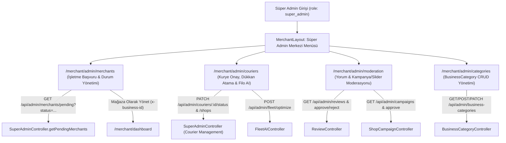

# Story 91: Web Süper Admin Yönetim Merkezi ve Moderasyon Altyapısı

## 1. Amaç ve Kapsam
Hoppa ekosisteminin uçtan uca yönetimi için `apps/web_app/` altında kurumsal tasarıma (Story 90: `MerchantLayout`, `MerchantThemeContext`, `HoppaSelect`, `tabular-nums`, strictly typed TypeScript) tam uyumlu **Süper Admin Yönetim Merkezi** oluşturulması ve eksik backend listeleme/filtreleme endpoint'lerinin tamamlanmasıdır.

## 2. Mevcut Durum ve Tespit Edilen Eksikler
* **`backend/src/routes/adminRoutes.ts`**: `authMiddleware` ve `req.user?.role !== "super_admin"` koruması mevcuttur, ancak moderasyon kuyruklarını listelemek için `GET /reviews` ve `GET /campaigns` rotaları eksiktir.
* **`backend/src/controllers/SuperAdminController.ts`**: `getPendingMerchants` metodu şu an `status: { in: ["PENDING", "REVISION", "ON_HOLD"] }` filtresini sabit (hardcoded) olarak uygulamaktadır. Aktif (`ACTIVE`), reddedilmiş (`REJECTED`) veya tüm işletmelerin admin panelinde filtrelenebilmesi için opsiyonel `?status=` sorgu parametresi desteği gereklidir. (`updateMerchantStatus` `$transaction` içinde `Shop` oluşturur; `getCouriers`, `updateCourierStatus`, `assignCourierToShop`, `removeCourierFromShop` hazır durumdadır.)
* **`apps/web_app/src/components/merchant/MerchantLayout.tsx`**: `isAdmin = profile?.role === 'super_admin' || profile?.role === 'admin'` tanımı ve `merchantApiFetch` içinde `x-business-id` / `shopId` bağlam geçişi hazırdır, ancak Süper Admin'e özel yönetim sayfaları mevcut değildir.

## 3. Mimari Akış Diyagramı

## 4. Teknik Tasarım ve Değişiklik Listesi

### 4.1. Backend (`backend/`)
1. **`backend/src/controllers/SuperAdminController.ts`**:
   * `getPendingMerchants`: Opsiyonel `?status=` query parametresi (`PENDING`, `REVISION`, `ON_HOLD`, `ACTIVE`, `REJECTED` veya `ALL`) ve metin arama (`?search=`) desteği eklenir. Parametre verilmezse geriye dönük uyumlu olarak `["PENDING", "REVISION", "ON_HOLD"]` döner.
2. **`backend/src/controllers/ReviewController.ts`**:
   * `getAdminReviews(req, res)`: `?status=PENDING|APPROVED|REJECTED|ALL` filtresi ve sayfalama ile kullanıcı, dükkan ve sipariş bilgilerini içeren moderasyon listesi döner.
3. **`backend/src/controllers/ShopCampaignController.ts`**:
   * `getAdminCampaigns(req, res)`: `?status=PENDING|APPROVED|REJECTED|ALL` filtresi ile mağazaların kampanya ve slider taleplerini listeler.
4. **`backend/src/routes/adminRoutes.ts`**:
   * `GET /reviews` -> `ReviewController.getAdminReviews`
   * `GET /campaigns` -> `ShopCampaignController.getAdminCampaigns`

### 4.2. Web Portal (`apps/web_app/`)
1. **`apps/web_app/src/components/merchant/MerchantLayout.tsx`**:
   * `activeTab` tipi `'admin-merchants' | 'admin-couriers' | 'admin-moderation' | 'admin-categories'` değerlerini kapsayacak şekilde genişletilir.
   * `isAdmin` kontrolü true olduğunda sol menüde **"Süper Admin Merkezi"** grubu görünür hale getirilir.
2. **`apps/web_app/src/pages/merchant/admin/merchants.tsx`**:
   * Durum filtresi (`HoppaSelect`: Bekleyenler, Revizyon/Askıda, Aktif, Reddedilenler, Tümü), başvuru detay çekmecesi, tek tıkla durum güncelleme (`ACTIVE` / `REVISION` / `ON_HOLD` / `REJECTED`) ve `selectedShop` set ederek `"Mağaza Panelini Aç"` (`x-business-id` impersonation) aksiyonu.
3. **`apps/web_app/src/pages/merchant/admin/couriers.tsx`**:
   * Kurye listesi (`APPLIED`, `INTERVIEWING`, `APPROVED`, `SUSPENDED`), durum onaylama, `CourierShop` üzerinden mağaza atama/kaldırma ve Filo AI optimizasyonu tetikleme paneli.
4. **`apps/web_app/src/pages/merchant/admin/moderation.tsx`**:
   * İki sekmeli moderasyon ekranı:
     * **Yorumlar:** Bekleyen müşteri yorumlarını onaylama (onay anında `$transaction` ile Hoppa Para ödülü tetiklenir) veya reddetme.
     * **Kampanyalar & Sliderlar:** Mağaza slider/kampanya taleplerini onaylama (7 günlük `ShopPromotion` oluşumunu doğrulama) veya reddetme.
5. **`apps/web_app/src/pages/merchant/admin/categories.tsx`**:
   * `BusinessCategory` listeleme, oluşturma, düzenleme (`shopType`, `badge` = `'yakında'` dahil, sıralama önceliği, aktiflik durumu).

## 5. Güvenlik ve Kod Kalitesi Kısıtlamaları
* Tüm backend rotaları `authMiddleware` ve `super_admin` rol koruması altında kalmalıdır.
* Web tarafında `any` tipi kullanılmamalı; tüm API yanıtları açık TypeScript arayüzleriyle tanımlanmalıdır.
* `window` / `localStorage` erişimleri yalnızca client-side (`useEffect` veya SSR guard) içinde yapılmalıdır.

## 6. Doğrulama Protokolü
* Backend: `cd backend && npx tsc --noEmit`
* Web App: `cd apps/web_app && npx tsc --noEmit && npm run build`
