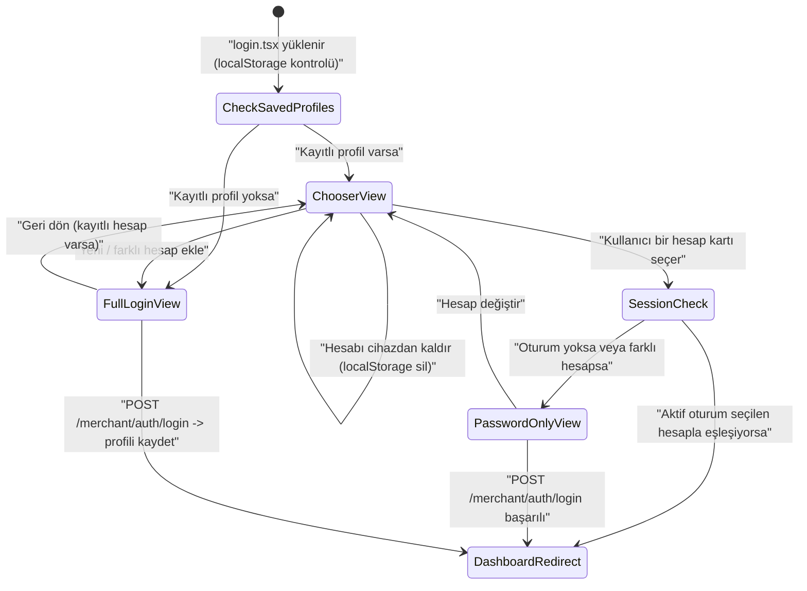

# Story 92: Web Satıcı Çoklu Hesap Girişi (Account Chooser), Yorumlar ve Sponsorlu Promosyonlar

## 1. Amaç ve Kapsam
Web Satıcı Portalında (`apps/web_app/`) aynı cihazdan birden fazla mağaza/satıcı hesabını güvenli şekilde yönetebilen **"Account Chooser" (Çoklu Hesap Seçici)** giriş akışının kurulması; ayrıca satıcıların müşteri değerlendirmelerini görüntüleyebilmesi (`reviews`) ve ana ekran/kategori vitrin promosyonlarını yönetebilmesi (`promotions`) için eksik portal sayfalarının ve backend rotasının tamamlanmasıdır.

## 2. Güvenlik ve Mimari İlkeler (Kritik)
* **`localStorage` Güvenliği:** Kaydedilen profiller listesinde **ASLA** düz şifre, pasif hesapların Access Token'ları, Refresh Token'ları veya hassas kişisel veriler (PII) saklanmaz. Yalnızca `SavedMerchantAccount` arayüzü (`id`, `email`, `merchantName`, `businessName`, `avatarUrl`, `role`, `lastLoginAt`) tutulur.
* **Oturum Doğrulama:** Kayıtlı bir profil seçildiğinde geçerli aktif oturum kontrol edilir; farklı bir hesaba geçiliyorsa veya aktif oturum yoksa kullanıcıdan **yalnızca o hesabın şifresi** (`password_only` modu) istenir.
* **XSS Koruması:** Satıcı ve işletme adları JSX içinde güvenli şekilde render edilir; güvensiz HTML enjeksiyonundan (`dangerouslySetInnerHTML`) kesinlikle kaçınılır.
* **Hata Dayanıklılığı:** Tüm `localStorage` okuma/yazma işlemleri `QuotaExceededError` ve bozuk JSON ihtimallerine karşı `try-catch` bloklarıyla korunur.

## 3. Mevcut Durum ve Tespit Edilen Eksikler
* **`apps/web_app/src/pages/merchant/login.tsx`**: Şu an yalnızca tek hesap için e-posta + şifre girişi sunar.
* **`apps/web_app/src/utils/merchant-auth.ts`**: Mevcut aktif oturum için `hoppa_merchant_token`, `hoppa_merchant_refresh_token`, `hoppa_merchant_profile`, `hoppa_merchant_selected_shop` anahtarlarını ve `x-business-id` başlığını yönetir.
* **`backend/src/routes/merchantRoutes.ts`**: `/promotions` (`ShopController.createPromotion`, `getPromotions`, `cancelPromotion`) ve `/campaigns` rotaları mevcuttur ancak satıcıya kendi dükkan yorumlarını döndüren `GET /api/merchant/reviews` rotası yoktur.
* **`apps/web_app/src/pages/merchant/`**: `reviews/index.tsx` ve `promotions/index.tsx` sayfaları henüz mevcut değildir.

## 4. Çoklu Hesap Giriş Akışı Diyagramı

## 5. Teknik Tasarım ve Değişiklik Listesi

### 5.1. Web Çoklu Hesap Girişi (`apps/web_app/`)
1. **`apps/web_app/src/types/auth.types.ts`**:
   * `SavedMerchantAccount`, `LoginViewMode` (`'chooser' | 'password_only' | 'login'`), `LoginFormValues` strict TypeScript tanımları.
2. **`apps/web_app/src/utils/saved-accounts.ts`**:
   * `getSavedMerchantAccounts()`, `upsertSavedMerchantAccount()`, `removeSavedMerchantAccount()` yardımcı fonksiyonları; `QuotaExceededError` ve JSON parse hatalarında güvenli fallback.
3. **`apps/web_app/src/components/merchant/AccountChooser.tsx`**:
   * Kayıtlı profilleri listeleyen kurumsal kart bileşeni (avatar/baş harf rozeti, sanitizasyonlu satıcı/işletme adı, e-posta, son giriş bilgisi, "Cihazdan Kaldır" butonu ve "Başka hesap kullan" aksiyonu).
4. **`apps/web_app/src/components/merchant/MerchantLoginForm.tsx`**:
   * Standart (`login`) ve yalnızca şifre (`password_only`) modlarını tek bileşende yöneten form (`selectedEmail` geldiğinde e-posta alanı salt okunur/devre dışı bırakılır ve şifre alanına otomatik odaklanılır, doğrulama şeması ile kontrol edilir).
5. **`apps/web_app/src/pages/merchant/login.tsx`**:
   * `view: 'chooser' | 'password_only' | 'login'` durum makinesi orkestrasyonu; başarılı girişte profili (tokensız olarak) `saved-accounts.ts` üzerinden cihaz listesine kaydetme.

### 5.2. Satıcı Yorumları ve Sponsorlu Promosyonlar (`backend/` + `apps/web_app/`)
1. **`backend/src/controllers/ReviewController.ts` & `backend/src/routes/merchantRoutes.ts`**:
   * `getMerchantShopReviews(req, res)` eklenir ve `GET /api/merchant/reviews` rotasına bağlanır. `merchantRoutes.ts` içindeki `x-business-id` / `shopId` SuperAdmin bağlam çözümlemesi ile tam uyumlu çalışır; yorum listesi, ortalama puan ve durum özetini (`PENDING`, `APPROVED`, `REJECTED`) döner.
2. **`apps/web_app/src/pages/merchant/reviews/index.tsx`**:
   * Ortalama dükkan puanı, yıldız dağılımı ve müşteri yorumları listesi (tarih, puan, durum rozeti, sipariş referansı).
3. **`apps/web_app/src/pages/merchant/promotions/index.tsx`**:
   * `ShopController` (`GET /merchant/promotions`, `POST /merchant/promotions`, `DELETE /merchant/promotions/:id`) ile entegre **Sponsorlu Vitrin & Promosyonlar** sayfası.
   * `MAIN_SCREEN` (%15 komisyon, 7 gün) ve `CATEGORY` (%10 komisyon, 7 gün) paket karşılaştırması (varsayılan %5 komisyona kıyasla şeffaf bilgilendirme), aktif promosyon kalan süre göstergesi, iptal ve `CATEGORY -> MAIN_SCREEN` yükseltme desteği.
4. **`apps/web_app/src/components/merchant/MerchantLayout.tsx`**:
   * `activeTab` ve yan menüye `'reviews'` (Müşteri Yorumları) ve `'promotions'` (Sponsorlu Vitrin) bağlantılarının eklenmesi.

## 6. Doğrulama Protokolü
* Backend: `cd backend && npx tsc --noEmit`
* Web App: `cd apps/web_app && npx tsc --noEmit && npm run build`
