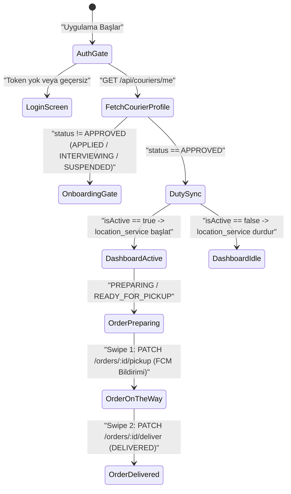

# Story 93: Kurye Uygulaması (Courier App) Production Dönüşümü ve Backend Senkronizasyonu

## 1. Amaç ve Kapsam
`apps/courier_app/` uygulamasını mevcut tek dosyalık prototip yapısından çıkararak gerçek kimlik doğrulama, kurye onay kapısı (onboarding gate), açılışta nöbet durumu (`isActive`) ve canlı konum motoru (`CourierLocationEngine`) senkronizasyonu, 2 aşamalı teslim alma/teslim etme (`pickup -> deliver`) akışı ve teslimat geçmişi/kazanç ekranlarıyla production-ready seviyeye getirmektir.

## 2. Mevcut Durum ve Tespit Edilen Eksikler
* **`apps/courier_app/lib/src/screens/dashboard/courier_dashboard.dart`**:
  * Giriş ekranında sabit kodlanmış test bilgileri (`+905555555555` / `123456`) yer almaktadır.
  * Lokal `_isOnDuty = false` durumu uygulama açılışında backend üzerindeki gerçek `isActive` durumuyla senkronize edilmemektedir.
  * `SwipeButton` doğrudan `PUT /api/couriers/orders/$orderId/deliver` çağırmakta; mağazadan teslim alma (`pickup`) adımı bulunmamaktadır.
  * Sipariş kalemi seçenekleri (`OrderItemOption`) ve müşteri notları kartlarda yer almamakta; geçmiş teslimatlar sekmesi bulunmamaktadır.
* **`backend/src/routes/courierRoutes.ts` & `backend/src/controllers/CourierController.ts`**:
  * Mevcut rotalar: `POST/PATCH /location`, `PATCH/PUT /toggle-duty`, `GET /orders`, `PATCH/PUT /orders/:id/deliver`, `POST /apply`, `GET /vehicle-options`.
  * Eksik rotalar: `GET /me`, `PATCH/PUT /orders/:id/pickup`, `GET /orders/history`.
  * `getAssignedOrders` şu an yalnızca `status: { in: ["PREPARING", "ON_THE_WAY"] }` ve `include: { shop, address, items: { include: { product } } }` döndürmekte; `READY_FOR_PICKUP` durumunu, `consumer` bilgisini ve `items.options` (`OrderItemOption`) verisini dahil etmemektedir.

## 3. Kurye Durum ve Sipariş Yaşam Döngüsü Diyagramı

## 4. Teknik Tasarım ve Değişiklik Listesi

### 4.1. Backend (`backend/`)
1. **`backend/src/controllers/CourierController.ts`**:
   * `getMyProfile(req, res)`: Kurye profili, `status` (`APPLIED | INTERVIEWING | APPROVED | SUSPENDED`), `isActive`, araç bilgisi, atanmış mağazalar (`CourierShop`) ve günlük teslimat sayısını döner.
   * `getAssignedOrders` güncellemesi: `status: { in: ["PREPARING", "READY_FOR_PICKUP", "ON_THE_WAY"] }` kapsanır; `include` içine `consumer` (`name`, `phone`), `address`, ve `items: { include: { product: true, options: true } }` eklenir.
   * `pickupOrder(req, res)`: İlgili siparişin kuryeye ait ve `PREPARING` veya `READY_FOR_PICKUP` aşamasında olduğunu doğrular; durumu `ON_THE_WAY` olarak günceller ve `NotificationService.sendToUser` ile müşteriye yola çıkış push bildirimi gönderir.
   * `getOrderHistory(req, res)`: Kuryenin tamamladığı (`DELIVERED`) siparişleri ve dönem/gün bazlı teslimat özetini sayfalı olarak döndürür.
2. **`backend/src/routes/courierRoutes.ts`**:
   * `GET /me` -> `CourierController.getMyProfile`
   * `PATCH /orders/:id/pickup` ve `PUT /orders/:id/pickup` -> `CourierController.pickupOrder`
   * `GET /orders/history` -> `CourierController.getOrderHistory`

### 4.2. Kurye Mobil Uygulaması (`apps/courier_app/`)
1. **Kimlik Doğrulama & Sabit Test Verilerinin Temizlenmesi:**
   * `courier_dashboard.dart` içindeki `+905555555555` ve `123456` test ön-doldurma değerleri tamamen kaldırılır.
   * Gerçek giriş/kayıt akışı modüler ekran ve API servis katmanına ayrılır.
2. **Onboarding Durum Kapısı (Status Gate):**
   * `GET /api/couriers/me` yanıtındaki `status` alanı `APPROVED` değilse (`APPLIED`, `INTERVIEWING`, `SUSPENDED`) kuryeye durumuna uygun bilgilendirme ve yenileme ekranı gösterilir; onaylanmamış kuryelerin nöbet açması engellenir.
3. **Nöbet (`isActive`) ve Konum Motoru (`location_service.dart`) Senkronizasyonu:**
   * Dashboard açılışında `_isOnDuty` state'i backend'den gelen `isActive` ile eşitlenir ve aktifse `CourierLocationEngine` dinleyicisi otomatik başlatılır, nöbet kapatıldığında güvenli şekilde durdurulur.
4. **2 Aşamalı Sipariş Yönetimi ve Detay Kartları:**
   * `PREPARING` / `READY_FOR_PICKUP` siparişler için **"Teslim Aldım"** (`PATCH /orders/:id/pickup`), `ON_THE_WAY` siparişler için **"Teslim Ettim"** (`PATCH /orders/:id/deliver`) kaydırma aksiyonu uygulanır.
   * Sipariş kartlarında ürün seçenekleri (`options`), müşteri sipariş notu, mağaza/teslimat adresine harita yönlendirme ve müşteri/mağaza arama butonları yer alır.
5. **Geçmiş ve Kazanç Sekmesi:**
   * `GET /api/couriers/orders/history` verisiyle günlük/toplam teslimat sayısı ve geçmiş sipariş detayları listelenir.

## 5. Doğrulama Protokolü
* Backend: `cd backend && npx tsc --noEmit`
* Courier App: `cd apps/courier_app && flutter analyze`
