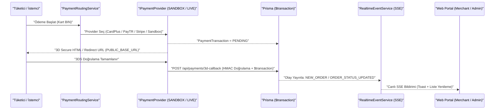

# Story 94: Sanal POS 3D Secure Ödeme Mimarisi ve Gerçek Zamanlı SSE Altyapısı

## 1. Amaç ve Kapsam
1. Mevcut ödeme akışındaki mock hemen-başarı davranışını kaldırarak Strategy Pattern (`IPaymentProvider`) tabanlı **gerçekçi 3D Secure ödeme yaşam döngüsüne** (`PENDING -> 3DS Doğrulama -> Atomik Callback`) geçmek ve KKTC (`CardPlus`), TR (`PayTR`) ve Uluslararası (`Stripe`) canlı adaptör iskeletlerini hazırlamaktır.
2. Web Satıcı Portalı ve Süper Admin Merkezi başta olmak üzere istemcilerin polling yükünü azaltan **SSE (`Server-Sent Events`) tabanlı gerçek zamanlı olay akışı** (`RealtimeEventService`) kurmaktır.

## 2. Mevcut Durum ve Tespit Edilen Eksikler
* **`backend/src/services/PaymentRoutingService.ts`**:
  * BIN tabanlı yönlendirme (`kktcBins` -> `CARDPLUS`, `trBins` -> `PAYTR`, diğerleri `STRIPE` + DCC `TRY->GBP` `0.025`) mevcuttur.
  * Ancak `MockPaymentService.processPayment` doğrudan `PaymentStatus.SUCCESS` döndürmekte ve sabit `https://hoppa-backend.onrender.com/mock-3d-secure?txId=...` yönlendirme URL'si üretmektedir.
* **`backend/src/index.ts`**:
  * `/mock-3d-secure` ve `/mock-3d-secure/callback` uçları doğrudan `index.ts` (satır 134–181) içinde gömülüdür.
* **Gerçek Zamanlı Olay Yayını:**
  * `NotificationService.ts` üzerinden mobil FCM bildirimleri mevcuttur ancak Web Portalı (`apps/web_app`) için yeni sipariş, durum güncellemesi veya moderasyon uyarısı taşıyan kalıcı bir SSE kanalı yoktur.

## 3. Ödeme ve Gerçek Zamanlı Olay Akış Diyagramı

## 4. Teknik Tasarım ve Değişiklik Listesi

### 4.1. Ödeme Sağlayıcı Mimarisi (`backend/`)
1. **Strategy Pattern (`backend/src/providers/payment/`):**
   * `IPaymentProvider.ts`: `initiatePayment`, `verifyCallback` (ve opsiyonel `refund`) sözleşmesi.
   * `Sandbox3DSPaymentProvider.ts`: `PAYMENT_PROVIDER_MODE=SANDBOX` (varsayılan) modunda çalışan, başlangıçta `PaymentStatus.PENDING` oluşturan ve `process.env.PUBLIC_BASE_URL` üzerinden dinamik 3DS URL'si üreten geliştirme/test adaptörü.
   * `CardPlusPaymentProvider.ts` (KKTC), `PayTRPaymentProvider.ts` (TR), `StripePaymentProvider.ts` (Uluslararası/DCC): `PAYMENT_PROVIDER_MODE=LIVE` modunda ilgili POS API ve imza doğrulama akışını uygulayan modüler adaptörler (eksik ortam değişkenlerinde sessiz hata yerine kontrollü hata fırlatma).
2. **Modüler Ödeme Route ve Controller (`backend/src/routes/paymentRoutes.ts`, `backend/src/controllers/PaymentController.ts`):**
   * `backend/src/index.ts` içindeki gömülü `/mock-3d-secure` ve `/mock-3d-secure/callback` rotaları temizlenerek `paymentRoutes.ts` altına taşınır (`/api/payments/3d-callback` ve sandbox sayfası).
   * Callback doğrulaması: Sağlayıcı imzası (HMAC) doğrulandıktan sonra Prisma `` `$transaction` `` içinde idempotent şekilde `PaymentTransaction` (`SUCCESS` / `FAILED`) ve ilişkili `Order` durumu güncellenir; başarı halinde `RealtimeEventService` ve `NotificationService` tetiklenir.

### 4.2. Gerçek Zamanlı SSE Mimarisi (`backend/` + `apps/web_app/`)
1. **`backend/src/services/RealtimeEventService.ts`**:
   * Kanal bazlı SSE abone havuzu (`shop:<id>`, `user:<id>`, `admin:global`).
   * Bağlantı kapanışında (`res.on('close')`) bellek sızıntısı önleme ve periyodik heartbeat (`event: ping`) gönderimi.
   * Desteklenen olay tipleri: `NEW_ORDER`, `ORDER_CANCELLED`, `ORDER_STATUS_UPDATED`, `COURIER_LOCATION_UPDATED`, `ADMIN_ALERT`.
2. **`backend/src/routes/eventRoutes.ts` & Controller Entegrasyonları:**
   * `GET /api/events/stream`: JWT doğrulamalı ve `x-business-id` SuperAdmin bağlamıyla uyumlu SSE uç noktası.
   * Mevcut sipariş, kurye konum ve moderasyon controller'larından ilgili olayların yayınlanması.
3. **`apps/web_app/src/utils/realtime-client.ts` & `MerchantLayout.tsx`:**
   * Otomatik yeniden bağlanma (exponential backoff) destekli SSE istemci hook'u.
   * Yeni sipariş geldiğinde anlık toast/sesli uyarı ve ilgili sayfa listelerinin otomatik yenilenmesi; bağlantı kesildiğinde mevcut polling mekanizmasının güvenli yedek olarak çalışması.

## 5. Doğrulama Protokolü
* Backend: `cd backend && npx tsc --noEmit`
* Web App: `cd apps/web_app && npx tsc --noEmit && npm run build`
* Tüketici Uygulaması (ödeme/sipariş modeli etkilenirse): `cd apps/consumer_app && flutter analyze`
