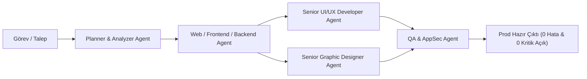

# Story 95: Kıdemli Grafik Tasarımcı & Kıdemli UI/UX Geliştirici Agent'ları ve Üretim Öncesi Tam Yığın Denetimi

## 📌 Genel Bakış ve Amaç
Bu hikaye, Hoppa monoreposunda prodüksiyon öncesi tespit edilen marka parçalanması, "yapay/AI-slop" tasarım kusurları, web/satıcı paneli/mobil UX eksiklikleri ve kritik güvenlik açıklarını kurumsal düzeyde çözmek üzere agent mimarisinin yükseltilmesini (`senior_graphic_designer_agent`, `senior_ui_ux_developer_agent`, güçlendirilmiş `qa_agent`) ve 4 fazlı iyileştirme yol haritasının kayıt altına alınmasını kapsar.

---

## 🤖 1. Yeni Agent Mimarisi ve Sorumluluk Akışı

### Eklenen / Güncellenen Agent Bileşenleri
1. **`.agents/skills/senior_graphic_designer_agent/SKILL.md` (+ `references/hoppa_brand_and_visual_standards.md`):**
   - Tekil vector marka kimliği (`logo-mark.svg`, `logo-full-light.svg`, `logo-full-dark.svg`), kanonsal `#FF6B00` / `#00A651` renk sistemi, sıfır emoji-ikon, sahte şeffaflık/cihaz çerçevesi yasağı, temiz `<defs>` ve konteynersiz kategori SVG kuralları, `< 2 MB` WebP/SVG varlık bütçesi ve Türkçe `İ`/`I` imla koruması.
2. **`.agents/skills/senior_ui_ux_developer_agent/SKILL.md` (+ `references/design_system_ux_and_security_checklist.md`):**
   - Çapraz platform tasarım token'ları, Tailwind v3.4 geçerli sınıf disiplini, FOUC-free Dark/Light tema, `tabular-nums`/`tabularFigures()`, Shimmer iskeletleri, sıfır sahte fallback veri/form, sıfır `alert()`/`confirm()`, Slide-Over Drawer ergonomisi, saha (`48x48dp`) Fitts Yasası ergonomisi, WCAG 2.1 AA ve arayüz güvenliği (XSS/CSP/SRI/`isAuthReady`).
3. **`.agents/skills/qa_agent/SKILL.md` (QA & AppSec Yükseltmesi):**
   - Sunucu taraflı fiyat/opsiyon/cüzdan bütünlüğü, `LIVE` ödeme webhook doğrulaması, explicit Prisma `select`, IDOR önleme, TLS/CORS/Upload/Sır hijyeni.
4. **`.agents/AGENTS.md`, `web_agent/SKILL.md`, `frontend_agent/SKILL.md` & `agent-remote-bridge/task_analyzer.py`:**
   - Eski `designer_agent` kaldırıldı; tüm ilgili kurallar ve Telegram yönlendirmesi yeni kıdemli agent'lara bağlandı.

---

## 🔍 2. Kod Tabanlı Denetim Özeti (Web + Satıcı Paneli + Mobil + Prod Güvenlik)

### 2.1. Web Vitrin & Satıcı/SuperAdmin Paneli (`apps/web_app/`)
* **Derlenmeyen Tailwind Sınıfları (23 Sınıf):** `border-3` (`orders/index.tsx:247`, `products/index.tsx:433`, `campaigns/index.tsx:141`, `catalog-import-modal.tsx:177`), `backdrop-blur-xs`, `shadow-xs`, `shadow-2xs`, `border-slate-105`, `animate-in`, `scrollbar-thin` Tailwind v3.4 derlemesinde düşüyor.
* **Marka & "Yapay" Arayüz Kusurları:** `src/app.tsx` içinde `animate-spin` `Sparkles`, 30+ emoji, 4 gri `
` harita (`L1434-1470`), dummy partner/iletişim formları (`L1616, L2047`), `"Merhaba, Test User"` ve mükerrer stok foto (`L48, L52`). `Hero "İşletme Girişi"` bağlantısı `/merchant/login` yerine `#partners` veriyor (`L515-521`); kurye formu `EN`/`RU` dillerinde Türkçe kalıyor (`L1735-1985`).
* **Satıcı Paneli & SuperAdmin Boşlukları:** `dashboard/index.tsx:107-117` sahte `₺12.450` / `Adana Kebap` fallback verisi ve statik operasyon sayaçları gösteriyor; 22 native `alert()`/`confirm()` çağrısı mevcut; `/merchant/finance` ve Menü Kategori CRUD yok; `campaigns/index.tsx:187` `"Kuponu Kaldır"` butonu işlevsiz; `/images/default-product.png` `404` veriyor; `reviews/index.tsx` boşta `5.00` gösteriyor ve yanıt özelliği yok; SuperAdmin `admin/categories.tsx`, `admin/couriers.tsx`, `admin/moderation.tsx` 1 tıkla onaysız silme/ret yapıyor; `KktcServiceZoneDrawerMap` sürüklenemeyen `circleMarker` kullanıyor.

### 2.2. Mobil Uygulamalar & Varlıklar (`apps/*`, `packages/`, `assets/`)
* **Tasarım Sistemi Parçalanması:** 794 `Color(0x...)`, 1.899 `Colors.*`, 91 çıplak `CircularProgressIndicator`, 296 ham `SnackBar`, 0/3 Dark Mode, 0 `cached_network_image`. `courier_app` `core_shared`'a bağlı değil; `merchant_app` doğrudan `consumer_app`'e bağımlı (`pubspec.yaml:54-55`) ve lacivert (`#1B2A4A`) renk şeması kullanıyor.
* **Görsel/Varlık Krizi:** `apps/consumer_app/assets/images/hoppa_button.png` sahte dama tahtalı `.png` uzantılı JPEG ve `ClipOval` olmadan basılıyor; 4 çelişen logo; `assets/images/auth_bg.png` `7.85 MB`; `campaign_invite_friend.png` telefon çerçeveli ve `< 1.8:1` kontrastlı; 32 ilkel SVG (`cat_*.svg`); `merchant_app/pubspec.yaml` görsel/ses varlıklarını deklare etmiyor.
* **Kritik Mobil UX Hataları:** `checkout_page.dart:470-488` adres seçimi kapalı; `payment_page.dart:348-365` sepeti 3DS sonucunu beklemeden temizliyor; `product_detail_page.dart:635-646` zorunlu opsiyonları atlıyor; `merchant_login_page.dart:480-515` gizli `DatabaseSeeder` içeriyor; `courier_dashboard.dart:494-530` Nöbet anahtarını onaysız Çıkış ikonunun `4px` yanına koyuyor ve uygulama içi harita sunmuyor.

### 2.3. Prodüksiyon Güvenlik Açıkları (Özet)
* **Kritik (`C-01`..`C-09`):** Doğrulamasız cüzdan para yükleme (`WalletController.ts:38-62`), istemci opsiyon fiyatı/negatif tutar manipülasyonu (`OrderController.ts:179-184`), ön-imzalı Stripe/PayTR `success_url` atlatma + kırık webhook (`StripePaymentProvider.ts`, `PayTRPaymentProvider.ts`), siparişte `passwordHash` & `identityNumber` sızıntısı (`OrderController.ts:510-515`), mobilde `badCertificateCallback => true` (`consumer_app/lib/main.dart:30-40`), kimliksiz `/local-upload` & SVG XSS (`media.routes.ts`), IDOR `submit-revision` (`MerchantAuthController.ts:174-205`), wildcard CORS reflection (`backend/src/index.ts:80-97`), hardcoded fallback `JWT_SECRET` / `PAYMENT_CALLBACK_SECRET`.
* **Yüksek (`H-01`..`H-10`):** Default `SANDBOX` & çift cüzdan iadesi yarışı (`OrderController.ts:939-999`), Leaflet XSS + SRI'sız CDN + `localStorage` refresh token, SSE URL query'de JWT (`realtime-client.ts`), Web CSP/HSTS/X-Frame-Options eksikliği, Git/APK içine gömülü `.env` anahtarları, `ThreeDSecurePage` origin doğrulama eksikliği, zayıf OTP PRNG & aktif test OTP kapısı, `flavor=consumer` Firebase App Verification kapatması, kurye GPS & kupon IDOR, backend üzerinden ham kart PAN/CVC geçirilmesi.
* **Orta (`M-01`..`M-05`):** Global `25mb` limit + limitsiz Gemini AI, Prisma `error.message` sızıntısı, atomik olmayan refresh token rotasyonu, cleartext `http://` fallback & `upgradeToMerchant`, prod mock `"Süleyman Kurye"` oto-ataması.

---

## 🗺️ 3. 4 Fazlı İyileştirme Yol Haritası
* **Faz A (Story 95A — Güvenlik Sertleştirme / Prod Blocker Giderimi):** `C-01`..`C-09` ve `H-01`..`H-10` maddelerinin kapatılması.
* **[Tamamlandı] Faz B (Story 95B — Hoppa Design System v2.0 & Vektör Marka Varlıkları):** SVG logomark/wordmark seti (`logo-mark.svg`, `logo-full-light.svg`, `logo-full-dark.svg`, `images/default-product.svg`), kanonsal token'lar (`tailwind.config.js`, `globals.css`, `hoppa_design_tokens.dart`, `hoppa_brand_widgets.dart`, `app_colors.dart`, `app_theme.dart`), 32 temiz kategori SVG'si ve optimize WebP/asset temizlikleri.
* **[Tamamlandı] Faz C (Story 95C — Kurumsal Web & Satıcı/SuperAdmin Panel Revizyonu):** Kırık Tailwind sınıflarının düzeltilmesi, FOUC-free Dark/Light tema + dinamik CartoDB harita döşemeleri + sürüklenebilir poligon köşeleri + XSS kaçışı, `ToastContext`/`useConfirm` & `SlideOverDrawer`, canlı SLA & gerçek dashboard grafikleri, Finans/IBAN (`GET /merchant/finance`, `PUT /merchant/finance/bank`) & Menü Kategori CRUD & Kupon CRUD & Yorum Yanıt modülleri, SuperAdmin onay kapıları ve gerçek `/public/merchant-inquiry` & `/public/contact` formları + TR/EN/RU yerelleştirmesi.
* **Faz D (Story 95D — Mobil Uygulamalar UX & Saha Ergonomisi Revizyonu):** Paylaşılan `core_ui`, Shimmer + `CachedNetworkImage`, Checkout/3DS/Opsiyon akış düzeltmeleri, `merchant_app` Bottom Nav, `courier_app` harita + güneş kontrastı + güvenli Nöbet/Çıkış ayrımı.
